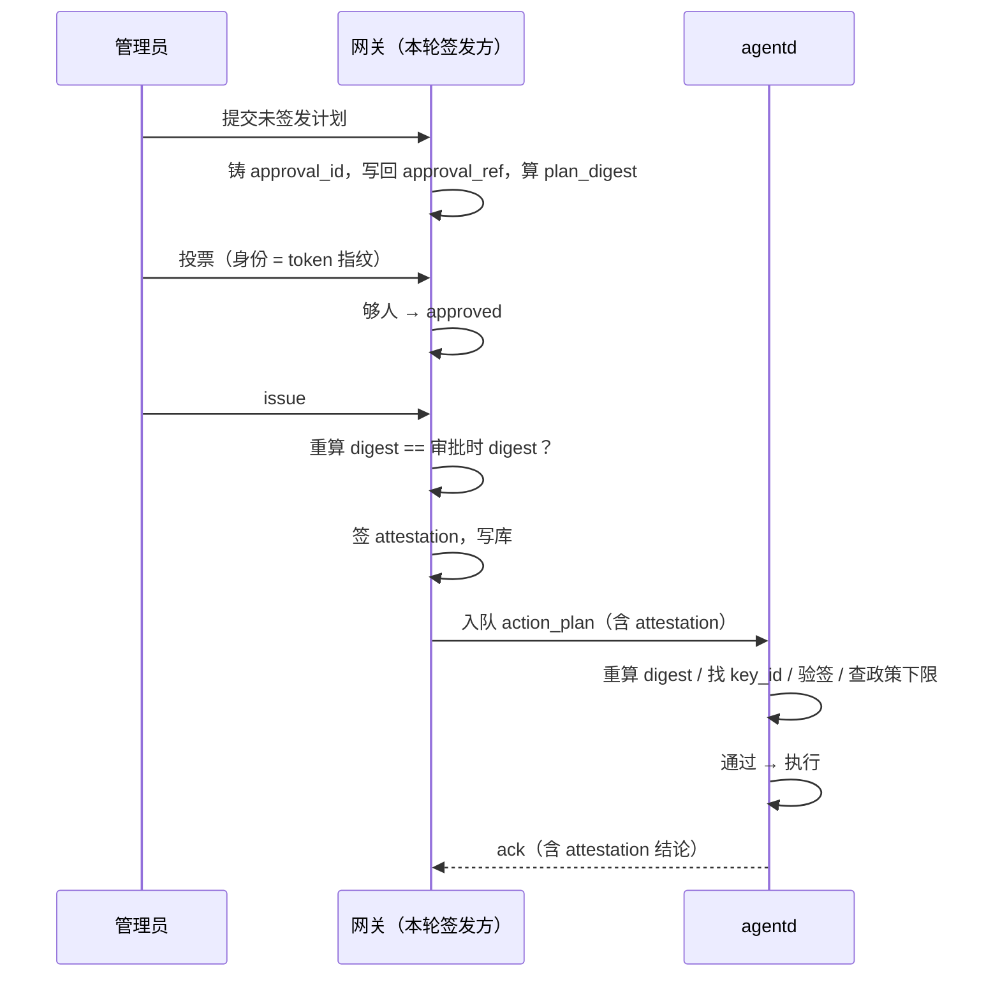

# 执行计划的签发证明（Plan Attestation）

> 状态：已落地（E3 / 响应能力 B 线第一阶段）。
> 适用仓：`wist-contracts`（类型与摘要）、`wist-validate`（形状）、`wist-agentd`（验签）、
> `wist-gateway`（审批与签发）。

## 1. 它解决什么问题

「响应能力」让控制面能在被管机上删文件、改配置、轮转日志。这些动作有副作用，
所以需要一个能离线回答的问题：

> 这份计划，是不是有人**明确批准过**的那一份？

E2 之前只有 `constraints.approval_ref` 一个字符串 —— 它由**发送方自己填**。
网关被控、中心被控、或者链路被改一个有权限的人，都能把它填成任何值。

签发证明把这句承诺变成**可验证的字节**：

- 控制面用私钥签一份 `ActionPlanAttestation`；
- 被管端用**本地钉死的公钥**验签；
- `attestation.plan_digest` 把「这份证明」与「这份计划」绑死。



## 2. 为什么签的是 attestation，不是整份 plan

签名覆盖自身会产生**自引用**：签名是 plan 的一部分，签名的内容又包含签名。

所以拆成两层：

| 层 | 内容 | 是否被签 |
|---|---|---|
| 计划 | `meta` / `target` / `constraints` / `program` | **否**（但被 `plan_digest` 覆盖） |
| 证明 | `plan_digest` + 审批事实 + 签发元数据 | **是** |

`attestation.plan_digest` 是桥梁：证明里写的是「我批的是这个摘要」。
被管端先重算摘要、再验签 —— 两步都过，才说明「这份内容 + 这份审批」是同一对。

## 3. 规范化规则（三端必须一致）

摘要：`plan-v1:sha256:<64 hex>`，内容是：

1. `serde_json::to_value(plan)`；
2. 对象里删掉 `attestation`（签名载体不在被签范围内）；
3. **递归**排序对象键、无空白、紧凑输出（数组保持顺序）；
4. 对结果字节做 sha256。

为什么不另写一个「摘要专用」的镜像结构体：那样每新增一个字段都得记得同步一次。
忘一次，新字段就不在摘要范围内 —— 攻击者可以改它而签名照样通过。这是**静默**的安全洞。
现在用的是「序列化 → 排序键」，新字段自动进入摘要范围。

被签字节（`signing_payload()`）= `attestation` 去掉 `signature` 后的同一套规范 JSON。
同理：新加字段自动进签名范围。

> 黄金向量：`wist-contracts` 的 `sample()` 计划，摘要恒为
> `plan-v1:sha256:a57a1ac0ef79ddb72b41bf32d5dd57884865d9f5dd97719c3ed5742397242108`。
> 这条测试存在的意义是：任何改动规范化规则的提交都必须**显式**更新它。

## 4. 审批绑摘要，不绑 action_id

审批的语义是「批准了**这一份**」，不是「批准了这个动作」。

- `action_approval.plan_json` 存审批时的计划原文；
- `issue` 时**重算**摘要并与审批时的比；
- 不等 → `409 plan_changed_since_approval`，走**重新审批**，绝不用新内容重签。

`approval_id` 由网关铸，并**写回** `constraints.approval_ref`（客户端提交时填的一律覆盖）。
否则它可以先写一个自己的引用，审批完再拿走。

id 形如 `apv_{agent}_{micros}_{rand4}`。随机后缀与有界重试解决的是「同一微秒两次提交
会撞主键」—— 那本应是调用方的重试，却会变成一个 500。

## 5. 执行侧的判定顺序

`agentd` 的 `plan_review` 在原有 4 项（结构 / 过期 / 目标 / 能力+审批引用）之后：

| # | 检查 | 错误码 |
|---|---|---|
| 1 | R2/R3 且 `enforced` 时必须带证明 | `attestation_missing` |
| 2 | 本地重算 `plan_digest` == `attestation.plan_digest` | `plan_digest_mismatch` |
| 3 | `key_id` 命中本地信任锚 | `unknown_signing_key` |
| 4 | 用本地公钥验 `signing_payload()` | `signature_invalid` |
| 5 | `constraints.approval_ref` 非空 | `approval_mismatch` |
| 6 | `attestation.risk_level` ≥ 计划声明 | `approval_risk_mismatch` |
| 7 | `required_approvers` ≥ 本机下限（R2=1、R3=2） | `approval_insufficient` |
| 8 | `now < attestation.expires_at` | `attestation_expired` |

`wist-validate` 已经在**形状**层面查过的东西（签名长度、审批人非空且不重复、
`approval_ref` 与 `approval_id` 相等、窗口顺序、证明不晚于计划）这里**不重复** ——
但 `validate` **不验签**：验签需要信任锚，只有执行侧有。

### 5.1 双下限

- `required_approvers` 在**签名覆盖**范围内（签发方声明的）；
- `policy_min_approvers` 在 **agentd 硬编码**（执行侧不接受更松的）。

两者取更严。想收紧就两边都改 —— 这也是为什么 gateway 与 agentd 各写一份下限，
而不是共享常量：一方被改，不会让另一方自动放宽。

## 6. `enforced` 是开关，不是版本

```toml
[attestation]
enforced = false
trusted_keys = [{ key_id = "gw-plan-k1", public_key_pem_file = "/etc/wist-agentd/gw.pub" }]
```

- `false`：**仍然会验**，只是不拦。失败原因进日志（`event=ActionPlanAttestationNotVerified`）
  与命令结果的 `detail`。
- `true`：R2/R3 没有可信证明就拒。

灰度靠翻这个开关，不需要发版 —— 出问题时第一个动作应该是关掉它，而不是回滚整台机器。

`enforced=true` + 空 `trusted_keys` ⇒ 所有 R2/R3 都被拒（`unknown_signing_key`）。
这是 fail-closed：宁可拒绝，也不要「没配就当没这项」。

**升级顺序**：`AgentConfig` 是 `deny_unknown_fields`，旧 agentd 读到 `[attestation]` 会拒启。
先升 agentd，再加配置段（建议先 `enforced=false` 观察一轮）。

## 7. 信任锚的轮换

`trusted_keys` 是**列表**，可以新旧并存：

1. 新公钥加入列表（此时签发方仍用旧钥）；
2. 签发方切到新钥（`key_id` 变了）；
3. 旧计划自然过期后，移除旧公钥。

为什么必须并存一段时间：已签发未执行的计划还在路上，立刻移除旧钥会让它们全部
`unknown_signing_key`。轮换窗口应该 ≥ `plan.attestation.ttl_seconds` 与计划的 `expires_at`。

**公钥只能来自本地绝对路径**。绝不「每次向网关要公钥」：那等于让被控方自己决定信任谁。

公钥文件每次 `review` 重新读（换锚不需要重启 agentd），并限了 8 KiB 上限。

### 7.1 签发私钥的文件权限

网关启动期会检查 `[plan_signing] key_file` 的 POSIX mode：**「其他用户」有任何权限就拒启**
（`0644` 是典型事故）。`0600` 推荐，`0640`（容器里的服务组）允许。

理由：私钥是「审批」这一层唯一的根。同一台宿主机上的任何进程能拷走它，审批就只剩形式。

生成：

```bash
mkdir -p state
openssl genpkey -algorithm ed25519 -out state/plan-signing.key
chmod 600 state/plan-signing.key
```

`PlanSigner` **同时接受两种 PKCS#8 布局**：

- OpenSSL 的标准输出（seed 包在嵌套 OCTET STRING 里）—— ring 的 `from_pkcs8` 对它回
  `VersionNotSupported`，所以代码里加了回退解析；
- `ring` 自己生成的格式（测试夹具用）。

前者是运维实际会用的命令，因此真机自检必须覆盖它 —— 只用 ring 生成的密钥测，会把
“文档里的命令跑不通”漏到现场。

启动日志里有一行 `event=PlanSigning configured=true key_id=…`：配置是否生效不必等到第一次审批。

## 8. 边界：这些**不**解决

### 8.1 被控主机的 root

拿到机器 root 的人可以：改 `[attestation]` 开关、换公钥、甚至绕过 agentd 直接删文件。

本机制的语义是「**在 agentd 正常运行时**，R2/R3 计划必须由持有私钥的那一方签发」。
它不是对抗本地 root 的机制。要发现「root 干了什么」，只能靠中心侧的**外部证据**
（审批单与实际执行结果的比对、机器状态的独立探测）。

### 8.2 网关被控（本轮）

**本轮私钥在网关**，是刻意的临时状态：审批与签发同在控制面才能先把闭环跑通。

代价：网关被控 ⇒ 它可以自签任意计划。这与 E2 相比并没有变差（那时它本来就能发任意计划），
但**不能**被当成「已经有了不可抵赖的审批」。

这一点必须在文档和部署说明里写明，直到 center 接手签发。

### 8.3 R3 在单 admin token 下不可用

审批人 = `admin:<sha256(token) 前 12 位>`。一个网关只有一个 admin token ⇒ 只有一个身份。

所以：
- R2（1 人）可用；
- R3（2 人）在 `create` 时直接回 `409 approval_policy_unsupported`，并说明需要 center 的用户体系。

早失败好过在 `issue` 时说「人数不够」。

### 8.4 风险等级被低报

审批强度取自 **plan 自己声明的** `constraints.risk_level`：网关没有 op → risk 的映射表，
那是 agentd 的 opcode 注册表。所以一份 R3 副作用的计划如果自称 R0，网关会允许它直接下发（E2 路径）。

拦它的是**执行侧**：`wist-exec` 在 `run_step` 里对每个 `invoke` 步比
`plan.constraints.risk_level` 与 `spec.risk`，低报 → `risk_understated`，一个文件都不动。

这是刻意的分层：

- 网关的审批强度是**策略**（按声明执行）；
- agentd 的风险降级检查是**安全闸**（按真实实现执行）；
- 想让网关也能拦，必须把 op → risk 表下发到网关——那会变成第三份名单，也会让「加一个 op」
  变成两个仓的联动改动。目前不值得。

要观测这种情况，看 agentd 回传的 `exit_reason = risk_understated`：它是一个**告警信号**
（说明有人在低报风险），而不是普通失败。

### 8.5 审批人身份只有 48 位（借用审计指纹）

`approvers` 里写的是 `admin:<sha256(token) 的前 12 位 hex>`，即 **48 位**指纹。

这不是为审批设计的身份体系，而是复用了全仓审计字段的既有口径
（`agent_commands.requested_by` / `investigation_grant.updated_by` / `agent_classification.decided_by`
都是这个形状）。当时选它的理由成立：原始 token 不能进库 / 进页面 / 进日志，
短指纹能区分轮换前后、且不可反推。

但 attestation 把「审计用的痕迹」提升成了「授权依据」，于是碰撞的后果变重了：

- 两个**不同**的 admin token 如果前 12 位相同，它们投的票会被当成**同一个人**；
- 对 R2（1 人）意味着「另一个人投的票算到你头上」；
- 对 R3（2 人）意味着可能凑不够两个不同审批人（虽然单 token 下本来就凑不够，见 §8.3）。

概率：48 位 = 2.8×10¹⁴，而部署里的 admin token 数量是个位数到十几个，
**当前不可利用**。但它不能当作“已经有真身份”的依据。

为什么不现在改成 16 位（64 位）：那会改变已有审计行里的 owner 值，
历史记录会与新记录对不上（「这个 `admin:ab12…` 到底是不是同一个人」）。
它与 `user:<id>` 迁移是同一件事，应该**一起**做（见 §9），而不是单独打一个字号补丁。

## 9. center 接手时的迁移路径

本轮网关侧的接口是照着「将来由 center 签发」设计的，迁移时**不需要改 agentd**：

1. 网关的 `POST /approvals` / `votes` 变成 center 的转发（或页面直接打 center）；
2. `plan_signer` 只在 center 配置；网关的 `[plan_signing]` 留空（`issue` 回 503）；
3. 审批人身份从 `admin:<token 指纹>` 换成 `user:<id>`（`approvers` 字段类型不变）——
   这同时也是 §8.5 那个 48 位指纹的正解（不是把它改长，而是不再需要它）；
4. agentd 侧只改一项：`trusted_keys[].public_key_pem_file` 指向 center 的公钥（或并存到切换完成）。

`attestation.issued_by` 已经区分了「哪台控制面签的」，所以迁移期两种签发方并存是可观测的。

## 10. 代码位置

| 关注点 | 文件 |
|---|---|
| 类型 / 摘要 / 规范 JSON | `wist-contracts/src/action_plan.rs` |
| 形状校验 | `wist-validate/src/action_plan.rs` |
| 验签 / 信任锚 | `wist-agentd/src/exec/attestation.rs` |
| 本地终审判定 | `wist-agentd/src/exec/plan_review.rs` |
| 配置段 | `wist-agentd/src/config/agent_config.rs`（`[attestation]`） |
| 审批表 | `wist-gateway/migrations/sqlite/0044_action_approval.sql` |
| 审批端点 | `wist-gateway/src/api/action_approvals.rs` |
| 签发 | `wist-gateway/src/infra/plan_signing.rs` |
| 下发 | `wist-gateway/src/api/action_plans.rs` |
