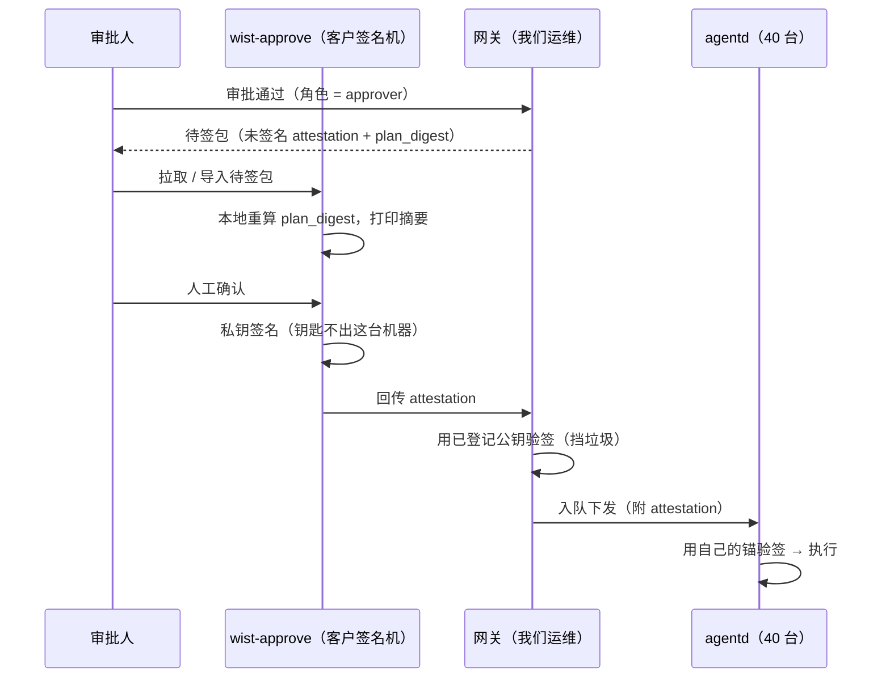

# 执行计划的外部签发（approval CLI）

> 状态：**设计稿（未实现）**。本文只定方案与接口，不代表代码已存在。
>
> **已决策**：V1 = 用 **CLI 审批**（`wist-approve`）；网关页面降为只读视图；单审批人（§8）；
> 将来再演进成客户侧签名服务 + 钉钉/手机（§12）。
>
> 关联文档：
> - [`plan-attestation.md`](./plan-attestation.md) — 证明的形状 / 规范化 / 审批 / 验签协议（本文不改它，只改「谁来签」）
> - [`wist-agentd/docs/design/plan-anchor-distribution.md`](../../../wist-agentd/docs/design/plan-anchor-distribution.md) — 锚怎么落到存量机队
>
> 一句话：**网关不再持有私钥，签名由审批人在自己的签名机上完成。**

## 1. 要解决的问题

`plan-attestation.md` §7.1 把签发私钥放在网关（`[plan_signing] key_file`），
`issue` 时由网关进程自签（`src/api/action_approvals.rs:612` 取 `plan_signer`、
`:706` 调 `signer.sign`）。

只要运维方（我们）持有这台网关的 admin 权限，**审批权就仍然是我们的**：

| 客户在页面上做了 | 我们能不能不点就达成同样效果 |
|---|---|
| 批准一条 R2 清理 | 能（私钥在我们进程里、队列也可写） |
| 拒绝一条 R2 清理 | 能（我们照样能签发并下发） |

所以「维护者=我们、审批者=客户」这个角色划分，在**网关自签**的形态下只是界面分工，
不是权力分工。要让审批权真的属于客户，只有一个办法：

> **私钥必须只在客户能控制的那侧使用；网关只收签名，不收钥匙。**

## 2. 目标形态



三个角色各持一样东西，互不代替：

| 角色 | 持有什么 | 我们能否伪造 |
|---|---|---|
| 网关（维护者） | 队列表、公钥登记表、页面 | 不能（没有私钥） |
| 审批人（客户） | **签署私钥** | 不能 |
| agentd | **信任锚（站点签署公钥）** | 不能（除非 root） |

网关侧的 `[plan_signing]` 在纯外部签发模式下**整段消失**：网关不再需要任何私钥，
最初那个 `503 plan_signing_unavailable` 的条件也随之改为「没有登记审批公钥」
（新错误码见 §6.4）。

## 3. 私钥承载形态

不用 KMS 也要能落地，所以把「钥匙存在哪」作为可选项而不是前提：

| 形态 | 私钥在哪 | 网关被控能伪造吗 | 无 KMS | 操作成本 | 适用 |
|---|---|---|---|---|---|
| **离线 CLI + 本地加密钥**（本文主线） | 审批人机器 | 不能 | ✅ | 中 | 默认 |
| KMS / HSM | 云 KMS、不可导出 | 不能 | — | 低 | 有云、要合规 |
| 硬件令牌（PIV/YubiKey） | 硬件 + PIN | 不能（但载荷仍由页面提供） | ✅ | 中 | 高保证要求 |
| 浏览器内签名 | 浏览器 | **页面由被约束方提供 → 可被要求签任意载荷** | ✅ | 低 | 不推荐（见下） |
| 页面导入私钥到网关 | **网关进程** | **能** | ✅ | 最低 | 仅客户自有网关 |

### 3.1 为什么「页面导入私钥」只在一处成立

如果网关运行在**客户自己的信任域**（客户自有 VPC / 单机部署），私钥落在网关等于落在客户手里，
可以接受。但只要网关的 admin 权限在我们手上，导入就等于把笔还给我们。

因此：**页面上导入私钥是「单机/离线部署形态」，不是「分离模式」。**
产品上必须按部署模型隐藏或允许这个入口，并在页面写清它等价于谁持有该机器。

### 3.2 为什么不在浏览器里签

1. 审批页由**被约束方**提供：页面可以要求这把钥匙签任意字节，也能在签名前替换摘要；
2. Ed25519 在 WebCrypto 里支持不全，引 WASM 密码库又把「页面完整性」变成本方案的依赖。

硬件令牌只解决「钥匙拿不走」，不解决「载荷谁给的」——除非令牌自带显示屏显示摘要。

## 4. 站点签署钥匙，不是每人一把

一个站点（一个信任域，例如某客户的 40 台）用**一把签署钥匙**：

| 模型 | agentd 要钉几把 | 审批人身份怎么体现 | 运维成本 |
|---|---|---|---|
| **站点钥匙（本文采用）** | **1 把** | 写在签名覆盖的 `approvers` / `required_approvers` 里 | 换钥匙 = 一次轮换 |
| 每人一把 | N 把（N = 审批人数） | 各自签名 | 每加一个人就要动 40 台 |

`ActionPlanAttestation` 的 `approvers` 在签名覆盖范围内（`plan-attestation.md` §3），
所以「谁批的」由签名方背书已经足够审计。真正的「每人独立密码学身份」需要多签契约（§8），
**不要**用「每人一把锚」去硬凑 —— 那会把 40 台变成 N 倍运维，且轮换窗口被拉到不可控。

钥匙的解锁要落在签名机上，建议：

- 文件用口令加密（或放 OS keychain），权限 0600；
- 密钥丢失 → 按 §7 轮换（换钥匙 = 换 agentd 锚）；
- 一个站点一把，不要跨客户复用。

## 5. 公钥的两处登记（两套生命周期）

同一个公钥要去两个地方，但它们的语义完全不同，**不能当作一个动作**：

| 落点 | 用途 | 信任语义 | 变更路径 |
|---|---|---|---|
| 网关 `approver_key` 登记表 | 收到签名后验一遍；页面显示指纹供人核对 | 只是**挡垃圾**，不是授权 | 随时可加 / 吊销 |
| agentd 锚目录 | `enforced=true` 时验不过就**拒绝执行** | **真正的授权** | 变更要过 40 台铺 / 收 |

顺序约束（与锚下发那篇一致）：

```
① 生成站点签署钥匙 → 导出公钥
② agentd 铺锚（enforced = false，advisory）
③ 网关登记公钥 + 打开外部签发
④ 金丝雀 R2 确认 detail「attestation 已验签」
⑤ 分环翻 enforced = true
```

反过来（先开外部签发、后铺锚）会出现「签了但没地方能验」，40 台的错误只会记成
`unknown_signing_key`，看起来像故障。

## 6. 接口改造

### 6.1 待签包

```
GET /api/v1/admin/approvals/{approval_id}/signing-payload
```

返回（只对 `status = approved` 且未签发的审批单可用）：

```json
{
  "approval_id": "apv_…",
  "agent_id": "agent-…",
  "approval": {
    "plan_digest": "plan-v1:sha256:…",
    "risk_level": "R2",
    "approvers": ["user:…"],
    "required_approvers": 1,
    "approved_at": "…",
    "expires_at": "…"
  },
  "plan": { "api_version": "v1", "kind": "action_plan", "…": "…" },
  "signing_payload": { "…": "去掉 signature 的 attestation" }
}
```

`signing_payload` 就是 `ActionPlanAttestation::signing_payload()` 的输出 ——
**由网关生成、由 CLI 独立重算校验**，两者必须一致（`plan_digest` 已有黄金向量，
见 `plan-attestation.md` §3）。

### 6.2 提交签名后的 attestation

```
POST /api/v1/admin/approvals/{approval_id}/issue
Content-Type: application/json
{ "attestation": { "...": "CLI 产出的完整 attestation（含 signature）" } }
```

- 请求体**省略**（或 `attestation: null`）→ 保持现状（网关自签，需 `[plan_signing]`）；
- 请求体**存在** → 走外部签发模式，不做本地签名。

前提：审批单必须是 `approved`（投票已落库）。**不能先签后批** —— 待签包里的
`approvers` 取自投票表，顺序反了就只能回 `409 approval_incomplete`。

关于 `issued_by`：它在**签名覆盖范围内**，网关改不了（改了签名就废）。所以口径是：
`key_id` 必须是已登记且未吊销的，`issued_by` **声明了就算数**（日志里记下并与登记属主比对，
不一致打 `ApproverKeyOwnerMismatch` 告警）。**授权**来自签名 + 登记，不来自这个字段。

### 6.3 网关侧校验清单（缺一不可）

| # | 校验 | 不通过的错误码 |
|---|---|---|
| 1 | 形状（`wist-validate` 的证明校验） | `attestation_invalid` |
| 2 | `attestation.plan_digest` == **从库里 `plan_json` 重算**的摘要 | `plan_digest_mismatch` |
| 3 | `attestation.approval.approval_id` == 路径里的 id | `approval_mismatch` |
| 4 | `approvers` / `required_approvers` 与投票记录一致 | `approval_mismatch` |
| 5 | `risk_level` 与库中计划一致 | `approval_risk_mismatch` |
| 6 | `key_id` 命中登记表且未吊销 | `approver_key_unknown` |
| 7 | 签名用该公钥验过 | `signature_invalid` |

**防 confused deputy**（这条是整个改造的安全核心）：

> 端点只接受「与库中**已批准的那份计划**摘要一致」的 attestation。
> 计划原文只从库里读，**绝不从请求体读**；`issued_by` 由网关按登记公钥的属主填写，
> 不接受客户端声明。

否则这个端点会退化成「拿任意计划来换签名」的预言机 —— 而签名是这个系统里唯一的授权凭证。

### 6.4 错误码与配置语义

| 现状 | 外部签发模式 |
|---|---|
| 无 `[plan_signing] key_file` → `503 plan_signing_unavailable` | 无登记审批公钥 → `503 approver_key_unregistered` |
| `signer.sign` 失败 → 409 系列 | 校验清单（§6.3）失败 → 400/409 对应码 |

`[plan_signing]` 与外部签发**可并存**，按请求体是否带 `attestation` 分流；
两条路都不可用时回 `503`，错误码按「缺私钥」还是「缺公钥」区分（运维要能立刻知道该补哪个）。

### 6.5 登记表

```sql
-- 新增迁移：approver_key
approver_key (
  key_id       TEXT PRIMARY KEY,   -- 与 agentd 锚的 key_id 对应
  owner        TEXT NOT NULL,      -- user:<id> / admin:<指纹>（审计与展示）
  public_key   TEXT NOT NULL,      -- SPKI PEM
  fingerprint  TEXT NOT NULL,      -- DER 的 sha256 前 16 位（页面展示用）
  added_by     TEXT NOT NULL,
  added_at     TEXT NOT NULL,
  revoked_at   TEXT
)
```

两条写入规则：

- **重复导入同一 `key_id` = 轮换公钥**（owner / 公钥 / 指纹一起换）；
- **吊销过的行不会因为一次重导就复活**：必须显式带 `"reactivate": true`。
  吊销往往是一次安全事件（钥匙疑似泄露），不能被一张旧页面的重试静默撤销。
  判定放在 SQL 的 `CASE WHEN ? THEN NULL ELSE approver_key.revoked_at END` 里，
  避免「读到的还没吊销、写的瞬间被吊销」这种竞态。

页面在导入时**必须显示绑定后的指纹**，操作员与签名机上的 `wist-approve key show`
核对一致后再启用 —— 否则「导入公钥」这一步本身就成了可被替换的环节。

## 7. 审批程序（**先用 CLI**：`wist-approve`）

> **已决策：审批动作放在独立审批程序里，V1 就做成 CLI**；网关页面降为**只读视图**（谁提交了什么、
> 状态、结果、审计），**不提供批准入口** —— 两条审批路径必有一条会漂。
> 将来演进成客户侧签名服务 + 钉钉/手机审批，见 §12。

```
wist-approve key generate  --out ~/.wist/approver.key     # 生成密钥对（spki + pkcs8）
wist-approve key show      --key ~/.wist/approver.key     # 打印 key_id + 指纹（与页面核对）
wist-approve list          [--gateway …]                  # 待批 / 已批 / 已签发
wist-approve show          <approval_id>                  # 从待签字节渲染摘要 + 摘要指纹
wist-approve approve       <approval_id>                  # 记录投票（服务端事实）
wist-approve approve --sign <approval_id> --key …        # 一步：投票 + 签名 + 提交
wist-approve reject        <approval_id> [--comment …]    # 驳回（也是一票）
wist-approve sign          <approval_id> --key …          # 仅签名（不投票，用于已批单）
wist-approve submit        --attestation apv_….json       # air-gap：人工带回签名
wist-approve status        <approval_id>                  # 下发 / 执行结果
```

离线 / air-gap 场景下 `list` / `show` / `submit` 换成「文件带进带出」，中间步骤不变。

凭据：**approver scope 的 token**（`approvals:list|read|vote|submit-attestation`），
**不能**用 admin token —— 否则角色分离当场失效（§12.4）。

### 7.1 硬要求（否则它就是个签名预言机）

1. **本地重算 `plan_digest`**：从 `plan` 字节重新规范化再比，不能信包里的 hex；
2. **摘要从「将要被签的字节」派生**并打印人读形式：op / 关键参数 / 目标机 / 风险 / 有效期 /
   `approval_id` / 摘要指纹，操作员确认的是这个；
3. **私钥不出本机**：不落日志、不上传、不解密到临时文件；文件权限必须是 **0600**
   （比网关自签形态的 `0640` 更严：审批机是通用工作站，组可读已经算过宽）；
4. **二进制自身可验证**：`--version` 打印**发布版本 + 目标平台**（CI 把 tag 编进二进制，现场
   报障时对得上制品）；二进制摘要由网关 `/api/v1/approver/install/<triple>/digests` 给出；
5. **默认拒绝**：摘要里出现 CLI 不认识的字段就停下并要求 `--allow-unknown-fields`，
   防「新版本加了个危险参数、老 CLI 打摘要时没显示」；
6. **签完自检**：用本机公钥再验一遍，不过就不提交（不让“签了但验不过”的计划出门）。

### 7.2 输出示例（`show`）

```
审批单   apv_agent-host-a55a…_63c88454
风险     R2（写）
动作     disk.cleanup.apply
参数     target=tmp  min_age_hours=24  max_files=100  max_bytes=1.0 GiB
目标机   agent-host-a55a338d7723（MacBook-Pro-2.local）
有效期   2026-11-24T13:27:00Z
计划摘要 plan-v1:sha256:59be99dbd3a8…
签名     gw-plan-k1（指纹 a1b2c3d4e5f60718）
```

### 7.3 交互形态：`approve --sign` 一步完成

单审批人（§8）前提下，审批和签名在 CLI 里合到**一次操作** —— 合的是交互，不是信任边界：

```
wist-approve approve --sign <id>
  ① POST vote            → status = approved（事实落库）
  ② GET signing-payload  → 含 approvers + plan_digest
  ③ 本地重算摘要 + 打印 + 终端确认
  ④ 签名 → POST issue    → 网关验签 → 入队下发
```

两条硬约束：

- **① 必须在 ② 之前**：待签包里的 `approvers` 是服务端事实，不能由 CLI 自填（§6.3 校验 #4）；
- **③ 的终端确认不能省**：它是「签发会下发」前的最后一道人眼关口。

必须保留的次级入口（合并 ≠ 只留一条路）：

| 场景 | 走哪条 |
|---|---|
| 签名机就在手边 | `approve --sign`（默认） |
| 签名机在别的机房 / air-gap | `approve` → 过后 `sign` + `submit` |
| 批量处理多条 | 全部 `approve`，最后集中 `sign` |
| 只想看不想签 | `approve`（停在「已批准（待签）」） |

状态机（页面与 CLI 看到的是同一个）：

```
pending ──approve/reject──▶ approved ──（待签）──▶ issued ──▶ dispatched ──▶ 结果
                              │
                              └── 只 approve 时停在这里，直到 sign+submit
```

页面侧注意：**不要给批准按钮**。它只能展示状态；否则同一件事有两个入口，两边的校验一定会漂。

### 7.4 计划渲染器（与签名同源）

审批人看到的是 CLI **从将要被签的字节**渲染出来的摘要，不是网关给的文案：

- 好处：页面能不能骗人不重要了，渲染与签名同源；
- 代价：`op → 人读参数` 的映射表要在 CLI 里有一份；
- 规则：**遇到不认识的 op / 未知字段，直接拒绝并要求升级 CLI**，不能「大概显示一下」继续签
  （同 §7.1 第 5 条）。

实现上把渲染器放在库里（§12.3 的 `wist-approve-core`），CLI 与将来的服务/GUI 共用，
避免两份实现漂。

### 7.5 CLI 怎么到审批人手里：**网关分发（主推）**

```
客户机器 ──curl -k──▶ 网关 /api/v1/approver/install/<triple>/install.sh | sh ──▶ $HOME/.wist/bin
                       └── /api/v1/approver/packages/<triple>（二进制本体）
```

**为什么不是只发 GitHub Release**：审批人是**客户内部的人**，能访问的是自己那台网关；
隔离站点根本没有外网。网关是唯一必然可达的地址，与 agent 安装脚本同一条路径。

页面上也有入口：审批页底部的「安装审批终端」（`ApproverInstallHint`）按平台给出这一条
命令，基址取管理面的 **Agent 对外地址**（设置值优先、没设则用 `public_base_url`）。
不用页面自身的 `location`：页面在 nginx 的 `:8443`，审批人机器要连的是网关的 `:443`。

三条刻意的约束（都已落在 `src/api/approver_install.rs`）：

1. **公开、无鉴权**。二进制与安装脚本都不含凭据；真正要管的是 token 与私钥，
   它们**不随包分发**（token 按人签发、私钥由审批人自己生成）。
2. **完整性靠摘要、不靠 TLS**。安装脚本是 `curl -k` 下来的（新机器还不信任自签 CA），
   所以脚本内嵌二进制的 sha256，`/digests` 端点同时给出 `package_sha256` 与
   `script_sha256` —— 前者由脚本校验，后者供人手工核对。
3. **路径固定、平台白名单**。平台只认 `install_package.rs` 的三个 `PLATFORM_*`
   （与 agent 包同一个白名单），文件名是常量，不做目录遍历。

制品侧的口径：

| 平台 | triple | 形态 |
|---|---|---|
| Linux x86_64 | `x86_64-unknown-linux-musl` | **静态 musl** |
| Linux aarch64 | `aarch64-unknown-linux-musl` | **静态 musl** |
| macOS arm64 | `aarch64-apple-darwin` | 动态（系统 dylib，正常） |

Linux 必须静态：审批人是客户的人，跳板机常是 CentOS 7/8 这类老系统 —— 绑 glibc 版本的
制品在那边连加载器都过不去，而这是个只需要 `curl`+文件权限的单文件工具，没有任何需要
宿主 libc 的理由。CI 对**当次产物**自证 `statically linked`（与 wist-agentd 同一口径），
不靠人事后复核。

**triple 必须三处一致**：网关白名单 / CI 构建矩阵 / 栈的投放脚本。写错一处不会报错，
只会表现在「`/api/v1/approver/…` 一直 404」或「文件投了但一直 503」—— 因为网关只在自己
认得的那三个目录里找文件。

**默认零手工**：三个平台的制品烘在**网关镜像**里
（`/usr/share/wist/approver-package/<triple>/wist-approve`，见 `docker/Dockerfile`）。
镜像自带 = 与网关版本天然一致，且隔离站点（没有外网）也能分发；这也避开了「要求谁登录
网关主机手工投放一次」——多站点 / 四十台起步的现场，这一步一定会被漏，症状就是 503。

站点仍可**覆盖**单个平台（换 CLI 不必等网关发版），优先级高于镜像：

```bash
scripts/install-approver-package.sh --tag "$GATEWAY_TAG"      # 有外网：从 Release 拉
scripts/install-approver-package.sh --from ./downloads        # 隔离站点：用离线 tar.gz
scripts/install-approver-package.sh --check --tag "$GATEWAY_TAG"   # 看哪些平台被站点覆盖了
```

- 解析顺序：`<栈根>/configs/gateway/state/approver-package/<triple>/wist-approve` →（没有就）镜像内置。
  **站点覆盖不需要重启**容器（读的是挂载卷里的 `state/`）；镜像内置随网关版本走。
- **源基址** = `<仓库 + 发布渠道>`，下载地址 = `<基址>/<tag>/<文件名>`：
  缺省 `https://github.com/dayu-sec/wist-gateway/releases/download`，可换 COS 镜像
  `https://<COS 桶域>/wist-gateway`（对象键与 knowledge 同形）。
  **不要**复用 vars 里的 `ARTIFACT_HOME` —— 那是 wist-knowledge 的基址，仓库名不同。
- **故意不接进 localize**：隔离站点没外网，挂上去会让 `gops sys localize` 与升级的
  `regenerate` 阶段直接失败；内置之后也**不再需要** localize 帮忙。
- **覆盖会漂，内置不会**：站点覆盖的文件名固定，网关无从知道盘上那份是哪版 —— 所以投放脚本
  把 tag 记在 `state/approver-package/VERSION`，`--check` 会报「覆盖自哪个 tag」。
  覆盖只是少数场景（不等网关发版就换 CLI），日常应当就是「网关什么版本，CLI 就什么版本」。

由此带上的一条工程约束：`BUILTIN_PACKAGE_DIR` 必须与 `docker/Dockerfile` 的 `COPY` 目标
**逐字一致**，两边漂了就是现场 503 而单测全绿 —— 所以有一条单测直接 `include_str!` 那个 Dockerfile
并断言路径出现在里面。

## 8. 单审批人（已决策，短期不做多人）

**决策：R2 / R3 都是一人批一次。短期不做双人 / 多签。**

这与代码现状一致，不需要改契约：

| 位置 | 现状 |
|---|---|
| 网关 `required_approvers_for` | `R0/R1 = 0`，`R2 = 1`，`R3 = 1`（`src/api/action_approvals.rs:66`，测试 `:838` 断言） |
| agentd 执行侧下限 | `R2/R3 = 1`（`wist-agentd/src/exec/plan_review.rs:130`） |
| 契约 | `ActionPlanAttestation` 只有一个 `signature` —— 与「一人签」天然匹配 |

### 8.1 为什么这一版不做多签

1. **契约要改**：`signatures: [{key_id, approver, signature}]` 才能表达 2-of-2；
2. **锚要变 N 把**：如果每个审批人一把钥匙，agentd 就要钉 N 把，
   加一个审批人就要动整个机队（与 §4 的「站点钥匙」冲突）；
3. **没有真实需求**：现在所有 R2/R3 都是一人批，多签只会让页面和 CLI 都变复杂。

### 8.2 什么时候再回头看

满足任一条才重新评估（否则不做）：

- 出现「同一动作需两个不同人同意」的合规要求；
- 审批人从「同一岗位多人共用一把站点钥匙」变成「每人独立身份」；
- 那时一次做完：契约多签 + agentd 多锚/阈值 + CLI 多签 + 页面配额展示。

在此之前，对外口径必须写「单人审批 + 单签名」，不得宣传为双人/不可抵赖。

### 8.3 单审批人 ≠ 允许自批

「一人批」指的是**只需要一个审批人**，不是「同一个人可以既提交又批准」。两者要分开：

| 场景 | 行为 |
|---|---|
| 提交人 ≠ 审批人 | 默认允许（正常流程） |
| 提交人 = 审批人（同一身份） | **默认拒绝**（`409 self_approval_forbidden`） |
| 站点只有一个人（开发/单机） | 显式配置 `allow_self_approval = true` 才放行，并在页面标出 |

理由：它是「审批」而不是「自己写、自己盖章」。需要完全单人操作的环境是真实存在的（评估、
单机部署），但不能是**默认值** —— 否则 40 台上的审批就变回了形式。

## 9. 边界：不解决什么

- **本机 root**：可以改 agentd 锚、改 `enforced`、绕过 agentd 直接删文件（与
  `plan-attestation.md` §8.1 一致）；
- **签名机被控**：钥匙在别人手上时，本方案不提供额外保护；KMS 的价值就在这里（审计 + 不可导出）；
- **升级通道**：网关仍能推二进制（`upgrade.rs:1226` 只校验网关给的 sha256）。本方案只封住「审批」，
  不封「分发」。要把这层也封住，需要包签名或把升级纳入审批（见锚下发文档 §2.1）；
- **吊销在途证明**：删锚只能阻止新的；已签发未执行的计划仍会在 `expires_at` 内执行。
  应急流程：删锚 → 清队列 → 轮换 → 通报（见锚下发文档 §5.3）。

## 10. 落地顺序与验收

| 阶段 | 内容 | 验收 |
|---|---|---|
| 1 | 契约不变；网关加 `signing-payload` + `issue` 带 attestation + `approver_key` 登记表；页面去掉批准入口 | 用测试密钥走通「外部签 → 下发 → agentd 验过」 |
| 2 | `wist-approve`：`key` / `list` / `show` / `approve [--sign]` / `sign` / `submit` / `status` | 同一份包，CLI 独立重算的摘要与网关一致（黄金向量） |
| 3 | 站点签署钥匙 + agentd 锚（first batch 带外） | 40 台铺完，`enforced=false`，detail 出现「attestation 已验签」 |
| 4 | 分环 `enforced=true` | 抽样确认 R2/R3 正常、无 `unknown_signing_key` |
| 5 | 角色分离（维护者 / 审批者 + 禁止自批 + approver scope token） | 单账号无法完成一次 R2（除非显式 `allow_self_approval`） |

阶段 5 是角色模型（网关授权）的事，本文只依赖它「存在」；授权矩阵单独成文，不在这里展开。
单审批人（§8）不改变阶段 5 的目标：**一个人可以将就，但至少要分开「提交」和「批」这两个动作。**

## 11. 未决问题

1. **审批人身份体系**：现在只有 `admin:<token 前 12 位>`（`plan-attestation.md` §8.5）。
   外部签发天然要求 `user:<id>`，是否一并做掉（而不是先登记 `admin:<指纹>`）？
2. **KMS 后端**：CLI 是否支持 `--kms`（调用云 KMS 签名）作为同一接口的后端？
   倾向支持，但接口先按「本地私钥 + 可选 KMS」设计，不改变网关侧。
3. **吊销粒度**：吊销 `key_id` 会让该站点所有在途计划失效 —— 是否需要「只停止新签发」与
   「立即作废在途」两档？
4. **CLI 分发**：跟 agent 安装包同一条 artifact 通道，还是独立仓（客户要从我们的发布页取）？

## 12. 演进路线：CLI → 客户侧签名服务 → 钉钉/手机

V1 就是 **CLI 审批**（§7）。之后的形态是同一个东西换个外壳，但有一条不变量：

> **审批入口可以有多个（CLI / Web / 钉钉），签名执行体只能有一个：客户侧持钥的那个服务。**

手机上没有、也不应该有私钥 —— 所有「手机上点一下就签了」的实现，实质都是**服务代签**。

### 12.1 三个阶段

| 阶段 | 审批入口 | 谁持钥 | 签名在哪 | 保证强度 |
|---|---|---|---|---|
| **1. CLI（V1）** | 签名机终端 | 审批人机器上的加密钥文件 | 本机 | 私钥持有者亲自签 |
| **2. 客户侧签名服务** | CLI + 控制台 +（可选）Web | 客户 KMS/HSM，或服务账号下的加密钥 | 客户 VPC 内 | 认证到人 + 服务代签 |
| **3. 钉钉 / 手机** | 钉钉卡片 / 小程序 | 同上（服务） | 同上 | 同上，**比阶段 1 弱** |

阶段 2 顺带把 §11 的「KMS 后端」收编：KMS 是签名服务的实现细节，不是另一条路。

### 12.2 钉钉接入的四条硬约束

1. **服务不提供通用签名接口**。只接受 `sign(approval_id)`，内部校验：`status=approved` /
   `plan_digest` 与库里重算值一致 / `approvers` 与投票一致。绝无 `sign(payload)`。
2. **钉钉只是认证 + 界面，不是授权源**。回调必须验签（时间戳 + nonce + 签名）；
   openid → `user:<id>` 的绑定由管理员显式完成；映射变更要审计。
3. **「手机审批」的强度显式可选**：

   | 策略 | 手机上的行为 | 适用 |
   |---|---|---|
   | `vote_only`（**默认**） | 手机只能批，签名仍需持钥方手动触发 | 高风险动作、合规要求 |
   | `auto_sign` | 一点即签并下发 | 低风险、追求闭环速度 |

4. **渠道进审计**。落库起码要有 `channel`（`cli` / `web` / `dingtalk`），
   否则事后分不清「张三在签名机上签的」和「张三在手机上点的、服务代签的」。

### 12.3 现在就按「将来是服务」拆

```
wist-approve-core     密码学 + 规范化重算 + 计划渲染器（未知 op 拒绝）
   ├── wist-approve        CLI 薄壳
   └── wist-approve-svc    将来：客户侧服务（KMS 后端 + HTTP）
```

三条现在就要守：

1. **渲染器在 core 里**，不写在 CLI 的 `main.rs`；
2. **签名只有一个入口 `sign(approval)`**，CLI 现在也按这个形状实现；
3. **永远自己重算摘要**，从 CLI 到服务不变。

### 12.4 凭据与角色

- CLI / 服务都用 **approver scope** token，不用 admin token；
- 维护者（我们）「没有私钥」，所以签不了 —— 这是「审批权在客户」的技术兼现；
- 若某天要求「帮客户代签」，那是把 `approver_key.owner` 换成我们，必须在合同与页面上写清。

### 12.5 一个现实约束

钉钉要网络、要跳公网回调。**隔离安全区 / air-gap 站点用不了手机审批** ——
那种站点仍是「签名机 + 文件带进带出」。不要为了统一体验，给 air-gap 站开一条公网回调的口子。
